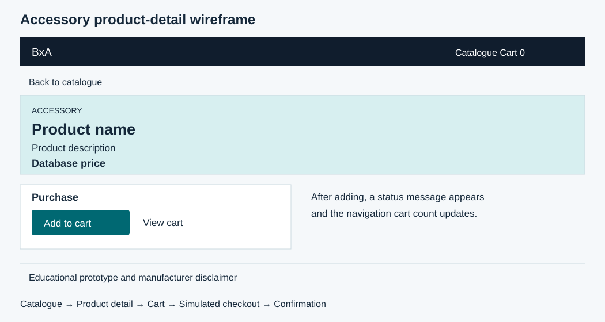
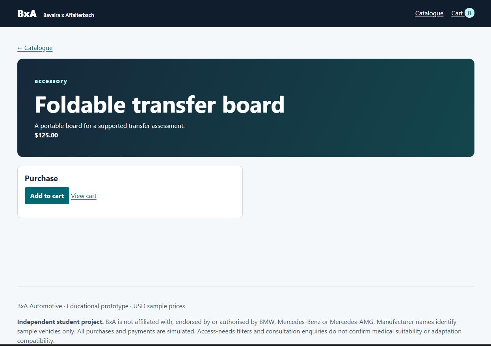
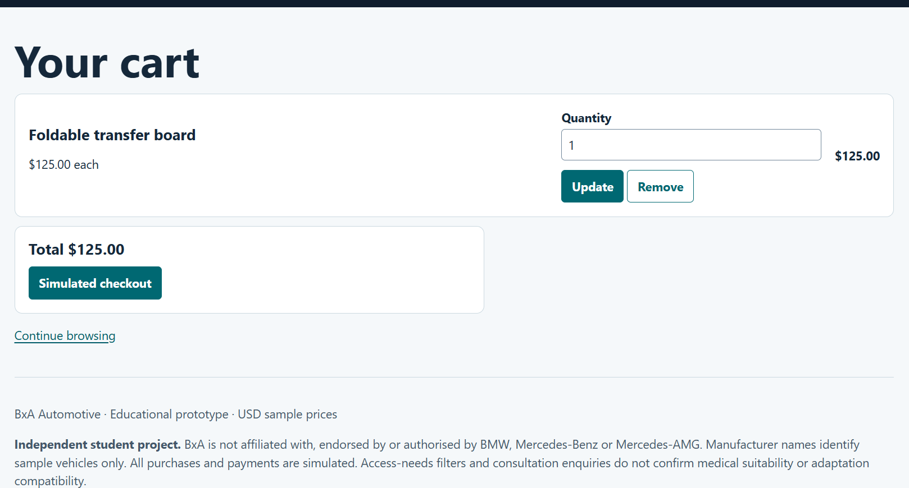

# BxA finalization and evidence

## Response to Phase 2 feedback released 16 November 2026

The final release incorporates the Phase 2 code and final validation fixes into
the default `main` branch. The root README includes installation, database and
test commands, the accessory-first demo sequence, and the manufacturer disclaimer.
The same disclaimer appears in the shared footer on every application page.

## Product detail between catalogue and cart

Open a product name in the catalogue to reach `/products/<id>`. For example,
`/products/5` shows Foldable transfer board, its description and $125.00 price.
The Purchase panel contains **Add to cart** and **View cart**. Adding posts the
product ID and form token to Flask. With JavaScript enabled, JSON updates the
cart count and the page announces Added to cart. Without JavaScript, the form
redirects to the cart. The cart shows quantity, unit price, subtotal, Update,
Remove and Simulated checkout. The final confirmation reads saved order records.

Vehicles add colour and trim choices. Their adaptation enquiry is stored in a
separate table. Access-needs tags filter accessories and do not establish
medical suitability or certify an adaptation.

## Scope and data

There are two sample vehicles, eight accessories and four access-needs categories.
Multiple selected access needs use AND matching. Prices are fictional USD amounts
stored as integer cents. The signed Flask session stores the cart. SQLite stores
products, options, tags, orders, order items and enquiries. Guest cart persistence
depends on the browser session cookie. Saved orders survive later catalogue-price
changes. No accounts, real payments, stock reservation or certified adaptation
matching are implemented.

## Verification on 17 November 2026

Eight automated tests passed in Python 3.12 with Flask 3.1.2. The suite covers
combined filtering, cross-vehicle option rejection, missing and malformed form
tokens, invalid quantity, removal, duplicate additions, an empty checkout,
stale cart forms, order snapshots, checkout retry, separate enquiries, and the
accessory detail-to-confirmation journey including the AJAX response and SQLite
order line.

A transfer-board test saved one item at 12,500 cents with a 12,500-cent order
total. The configured-vehicle test saved Polar White/Premium and the order price
snapshot. The test includes three organisers for a combined $155,450.00 total.

Earlier Chromium verification and the student's 9 November browser screenshots
support the Phase 2 checkout flow. On 17 November, the student ran the updated
release and captured the accessory detail page and the cart. The detail capture
shows Foldable transfer board, $125.00, Add to cart and View cart. The cart capture
shows quantity 1 and a $125.00 total. Both display the manufacturer disclaimer.
These two images support the detail-to-cart step. Full automated browser
verification of the final release was blocked in the assistant environment.
Broader cross-browser and assistive-technology testing remains future work.

## Final screenshots

Figure 1. Student-captured product detail on 17 November 2026. The cart count is
zero before adding. The name, description, price and Purchase controls are visible.

Figure 2. Student-captured cart on 17 November 2026. Quantity 1, unit price and total
are visible, along with Update, Remove, Simulated checkout and the disclaimer.

The printable evidence PDF in this directory places these screenshots beside the
product-detail explanation and a response to the five tutor conditions. The
separate two-page abstract summarises the final project.

## Assistance

ChatGPT assisted with implementation, testing, diagrams and documentation. The
student reviews the work, tests the application and explains the implementation
and reflection in their own words.
